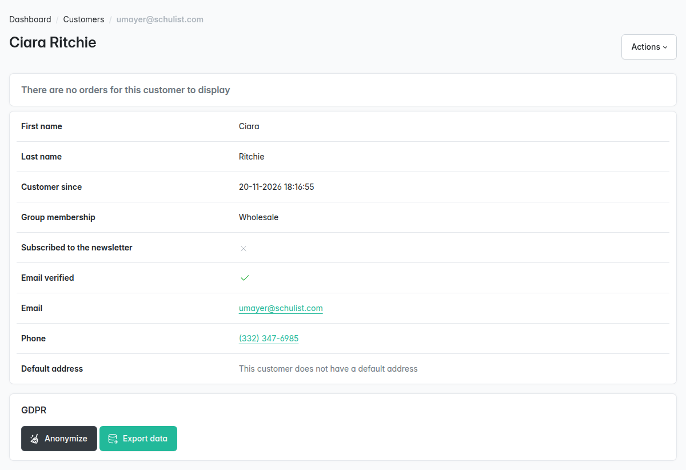

[](https://github.com/synolia/SyliusGDPRPlugin/blob/main/LICENSE)
[](https://github.com/synolia/SyliusGDPRPlugin/actions/workflows/analysis.yaml)
[](https://github.com/synolia/SyliusGDPRPlugin/actions/workflows/sylius.yaml)
[](https://packagist.org/packages/synolia/sylius-gdpr-plugin)
[](https://packagist.org/packages/synolia/sylius-gdpr-plugin)

# Sylius GDPR Plugin

Help your Sylius store comply with the GDPR: anonymize customers and export their personal data from the admin panel or the command line.



## Features

- **Anonymize a customer** from the GDPR section of the admin customer page.
- **Export customer data** as a JSON file from the same section.
- **Bulk anonymization** from the *GDPR* admin page: customers who have not logged in since a given date, or customers without any order.
- **Anonymize any entity** from the command line.
- **Configurable** anonymization (YAML mappings or PHP attribute) and export (Symfony Serializer groups).
- **Extensible**: events around anonymization and export, custom bulk actions.

## Requirements

|         | Version                   |
|:--------|:--------------------------|
| PHP     | ^8.3 (8.4+ for Symfony 8) |
| Sylius  | ^2.2.13                   |
| Symfony | ^6.4 \| ^7.4 \| ^8.0      |

## Installation

1. Require the plugin:

    ```shell
    composer require synolia/sylius-gdpr-plugin
    ```

2. Register the bundle in `config/bundles.php` if Symfony Flex did not do it:

    ```php
    Synolia\SyliusGDPRPlugin\SynoliaSyliusGDPRPlugin::class => ['all' => true],
    ```

3. Import the configuration in `config/packages/synolia_sylius_gdpr.yaml`:

    ```yaml
    imports:
        - { resource: "@SynoliaSyliusGDPRPlugin/Resources/config/app/config.yaml" }
    ```

4. Import the admin routes in `config/routes/synolia_sylius_gdpr.yaml`:

    ```yaml
    synolia_gdpr:
        resource: "@SynoliaSyliusGDPRPlugin/Resources/config/routes.yaml"
        prefix: '/%sylius_admin.path_name%'
    ```

5. Clear the cache:

    ```shell
    php bin/console cache:clear
    ```

## Anonymization

### Default mappings

The plugin ships with mappings for the Sylius `Customer`, `ShopUser`, `Address`, `Order` and `Payment` entities:
see [`src/Resources/config/mappings`](src/Resources/config/mappings).

### Custom mappings

Add your own mapping directories, and optionally disable the default mappings:

```yaml
synolia_sylius_gdpr:
    disable_default_mappings: false # default: false
    anonymization:
        mappings:
            paths:
                - '%kernel.project_dir%/config/gdpr/mappings'
```

Each file maps the properties of a class:

```yaml
Sylius\Component\Core\Model\Customer:
    properties:
        firstName:
            faker: firstName
            prefix: 'anonymized-'
        lastName:
            value: 'Fake lastName'
        phoneNumber: ~    # set to null
        defaultAddress: ~ # related entity: anonymized with its own mapping
        orders: ~         # collection: each item is anonymized with its own mapping
```

You can also configure a property with the `#[Anonymize]` attribute, which accepts the same options:

```php
use Synolia\SyliusGDPRPlugin\Attribute\Anonymize;

class Customer extends BaseCustomer
{
    #[Anonymize(['faker' => 'email', 'unique' => true, 'prefix' => 'anonymized-'])]
    protected $email;
}
```

| Option   | Description                                                                                              |
|:---------|:---------------------------------------------------------------------------------------------------------|
| `faker`  | [Faker formatter](https://fakerphp.org/formatters/) used to generate the value, e.g. `email`, `lastName` |
| `args`   | Arguments passed to the Faker formatter, e.g. `[20]`                                                     |
| `unique` | Generates a unique value (Faker `unique()` modifier)                                                     |
| `prefix` | String prepended to the generated value                                                                  |
| `value`  | Fixed value: `null`, a string, an int, an array or an expression                                         |

### Dynamic values

A `value` starting with `@=` is evaluated with the [Expression Language](https://symfony.com/doc/current/reference/formats/expression_language.html).
The `object` variable is the entity being anonymized:

```yaml
Sylius\Component\Core\Model\Customer:
    properties:
        email:
            value: '@="anonymized-" ~ object.getId() ~ "@example.com"'
```

### Command

Anonymize any entity from the command line:

```shell
php bin/console synolia:gdpr:anonymize --entity='Sylius\Component\Core\Model\Customer' --id=1
```

| Option          | Description                                    |
|:----------------|:-----------------------------------------------|
| `--entity`/`-E` | Fully qualified class name of the entity       |
| `--id`/`-i`     | Identifier of the entity. **Without it, every entity of the class is anonymized** |
| `--force`       | Skips the confirmation question                |
| `--reset`       | Resets the Faker unique generator              |
| `--max-retries` | Maximum number of retries to get unique values |

## Customer data export

The export serializes the customer with the `synolia:gdpr:customer_data` serialization group
(`Synolia\SyliusGDPRPlugin\Enum\GDPRSerializationKeyEnum::CUSTOMER_DATA`).
See the default configuration in [`src/Resources/config/serialization`](src/Resources/config/serialization).

To export more data, add this group to your own [serialization mapping](https://symfony.com/doc/current/serializer.html#using-serialization-groups-attributes),
for example with an attribute:

```php
use Symfony\Component\Serializer\Attribute\Groups;
use Synolia\SyliusGDPRPlugin\Enum\GDPRSerializationKeyEnum;

class Customer extends BaseCustomer
{
    #[Groups([GDPRSerializationKeyEnum::CUSTOMER_DATA])]
    protected ?string $loyaltyNumber = null;
}
```

## Custom bulk actions

The *GDPR* admin page lists bulk anonymization forms. To add yours:

1. Create a form type, and pass it to the controller with the `$formsType` argument:

    ```yaml
    services:
        Synolia\SyliusGDPRPlugin\Controller\AdvancedActionsController:
            arguments:
                $formsType:
                    - App\Form\Type\AnonymizeCustomersFromCountryType
            tags: ['controller.service_arguments']
    ```

2. Create a processor implementing `Synolia\SyliusGDPRPlugin\Processor\AdvancedActions\AdvancedActionsFormDataProcessorInterface`.
   It is registered automatically thanks to autoconfiguration.
   `getFormTypesClass()` returns the form types it handles, and `process()` receives the submitted form.

See [`AnonymizeCustomersNotLoggedBeforeProcessor`](src/Processor/AdvancedActions/AnonymizeCustomersNotLoggedBeforeProcessor.php) for an example.

## Events

| Event                                              | Dispatched                                        |
|:---------------------------------------------------|:--------------------------------------------------|
| `Synolia\SyliusGDPRPlugin\Event\BeforeAnonymize`         | Before anonymizing any entity                     |
| `Synolia\SyliusGDPRPlugin\Event\AfterAnonymize`          | After anonymizing any entity                      |
| `Synolia\SyliusGDPRPlugin\Event\BeforeCustomerAnonymize` | Before anonymizing a customer from the admin page |
| `Synolia\SyliusGDPRPlugin\Event\AfterCustomerAnonymize`  | After anonymizing a customer from the admin page  |
| `Synolia\SyliusGDPRPlugin\Event\BeforeExportCustomerData` | Before exporting the customer data               |

## Development

The plugin is developed and tested with the [Sylius Test Application](https://github.com/Sylius/TestApplication):

```shell
make install    # optionally: make install -e SYLIUS_VERSION=2.2.0 SYMFONY_VERSION=6.4
make phpunit
make serve      # or: APP_ENV=test symfony server:start -d
```

Use `vendor/bin/console` to run Symfony commands against the test application.

See [How to contribute](CONTRIBUTING.md) for more details (database configuration, versions, ...).

## License

This plugin is released under the [EUPL-1.2 license](LICENSE).

## Credits

Developed by [Synolia](https://synolia.com/).
